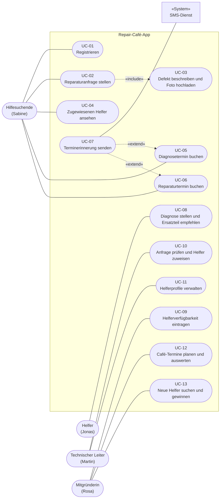

# Anwendungsfalldiagramm und Anwendungsfall – Repair-Café-App

## Anwendungsfalldiagramm

**Systemgrenze:** Repair-Café-App. Gestrichelte Pfeile zeigen «include» bzw. «extend». Fokus auf die 13 wichtigsten Anwendungsfälle, eindeutig nummeriert von UC-01 bis UC-13.

### Akteure

| Akteur | Persona | Beteiligte Anwendungsfälle |
|---|---|---|
| Hilfesuchende | Sabine | UC-01, UC-02, UC-04, UC-05, UC-06 |
| Helfer | Jonas | UC-08 |
| Technischer Leiter | Martin | UC-10, UC-11 |
| Mitgründerin | Rosa | UC-09, UC-12, UC-13 |
| «System» SMS-Dienst | – | UC-07 |

### Anwendungsfälle

| ID | Anwendungsfall | Akteur | Beziehung |
|---|---|---|---|
| UC-01 | Registrieren | Hilfesuchende | |
| UC-02 | Reparaturanfrage stellen | Hilfesuchende | «include» UC-03 |
| UC-03 | Defekt beschreiben und Foto hochladen | | wird von UC-02 eingebunden |
| UC-04 | Zugewiesenen Helfer ansehen | Hilfesuchende | setzt UC-10 voraus |
| UC-05 | Diagnosetermin buchen | Hilfesuchende | setzt UC-09 und UC-10 voraus, wird von UC-07 erweitert |
| UC-06 | Reparaturtermin buchen | Hilfesuchende | setzt UC-09 voraus, wird von UC-07 erweitert |
| UC-07 | Terminerinnerung senden | SMS-Dienst | «extend» UC-05 und UC-06, Bedingung: Hilfesuchende hat die SMS-Erinnerung aktiviert |
| UC-08 | Diagnose stellen und Ersatzteil empfehlen | Helfer | |
| UC-09 | Helferverfügbarkeit eintragen | Mitgründerin | fragt die Termine bei den Helfern ab, Voraussetzung für UC-05 und UC-06 |
| UC-10 | Anfrage prüfen und Helfer zuweisen | Technischer Leiter | Voraussetzung für UC-04 und UC-05 |
| UC-11 | Helferprofile verwalten | Technischer Leiter | |
| UC-12 | Café-Termine planen und auswerten | Mitgründerin | |
| UC-13 | Neue Helfer suchen und gewinnen | Mitgründerin | |

> Offen: Was bei der SMS-Erinnerung (UC-07) gilt, wenn keine Telefonnummer vorhanden ist und ob E-Mail eine Alternative ist.
>
> Offen: Grenze für „kurz“ beim einfachen Defekt (Alternativer Ablauf 7a).

---

## Strukturierter Anwendungsfall: Diagnose- und Reparaturtermin buchen

Abgeleitet aus dem Szenario „Sabines Kaffeemaschine bekommt ein zweites Leben".

| Feld | Inhalt |
|---|---|
| **Anwendungsfall-Name** | UC-02 Reparaturanfrage stellen, Diagnose- und Reparaturtermin buchen |
| **Akteure** | Primär: Hilfesuchende (Sabine). Sekundär: Technischer Leiter (Martin), Mitgründerin (Rosa), Helfer (Jonas), SMS-Dienst |
| **Ziel** | Das Gerät ist diagnostiziert und repariert. Falls ein Ersatzteil oder mehr Zeit nötig ist, hat die Hilfesuchende das Ersatzteil selbst gekauft und einen bestätigten Reparaturtermin. |
| **Vorbedingungen** | App ist installiert, Nutzerin ist registriert und angemeldet. Mindestens ein Helfer mit passenden Fähigkeiten ist vorhanden, und die Mitgründerin hat dessen verfügbare Termine eingetragen. |
| **Nachbedingung** | Anfrage, Diagnose und die gebuchten Termine sind gespeichert, der Helfer ist informiert. Hat die Nutzerin die SMS-Erinnerung aktiviert, sind Erinnerungen geplant. |

### Hauptablauf

1. Nutzerin wählt „Gerät reparieren lassen".
2. System fragt die Gerätekategorie ab, Nutzerin wählt „Küchengerät" und „Kaffeemaschine".
3. System zeigt typische Fehlerbilder, Nutzerin wählt passende Probleme aus.
4. System fordert ein Foto vom Typenschild an, Nutzerin lädt es hoch.
5. Der technische Leiter prüft die Anfrage, wählt anhand der Fähigkeiten der Helfer einen passenden Helfer aus und weist ihm die Anfrage zu (UC-10). Das System zeigt der Nutzerin den zugewiesenen Helfer mit Bewertung (UC-04).
6. Nutzerin wählt aus den freien Terminen des Helfers einen Diagnosetermin und bucht ihn (UC-05).
7. Beim Diagnosetermin prüft der Helfer das Gerät und erfasst die Diagnose sowie eine Empfehlung für das benötigte Ersatzteil, optional mit Richtpreis.
8. System schickt der Nutzerin die Ersatzteilempfehlung.
9. Nutzerin kauft das Ersatzteil selbst und markiert „Ersatzteil vorhanden".
10. System bietet freie Reparaturtermine beim selben Helfer an.
11. Nutzerin wählt einen Reparaturtermin und bucht ihn (UC-06).
12. System speichert den Termin und benachrichtigt den Helfer. Hat die Nutzerin die SMS-Erinnerung aktiviert, plant das System die Erinnerungen (UC-07).

### Alternativer Ablauf

- **4a.** Kein Typenschild auffindbar: Nutzerin überspringt das Foto und beschreibt das Gerät frei.
- **7a.** Einfacher Defekt (kein Ersatzteil nötig und Reparatur kurz): Der Helfer repariert direkt beim Diagnosetermin, Schritte 8 bis 12 entfallen.
- **7b.** Kein Ersatzteil nötig, aber die Reparatur dauert länger: Schritte 8 und 9 entfallen, die Nutzerin bucht ab Schritt 10 direkt den Reparaturtermin.

### Ausnahmen

- **5e.** Kein passender Helfer verfügbar: Die Nutzerin erhält einen Kontaktverweis auf Profis oder den Hersteller, die Anfrage endet.
- **6e.** Kein freier Termin beim zugewiesenen Helfer: Die Mitgründerin muss weitere Termine des Helfers eintragen (UC-09).
- **7e.** Reparatur lohnt sich nicht: Helfer vermerkt das, System schlägt Recycling oder Entsorgung vor.
- **9e.** Ersatzteil nicht erhältlich: Nutzerin meldet das, die Anfrage wird abgelehnt.

### Beteiligte Systeme

Repair-Café-App (Mobil-App), Backend mit Datenbank für Anfragen, Helfer und Termine, SMS-Dienst für Erinnerungen, Kartendienst für die Umkreissuche, Bildspeicher für Fotos.
